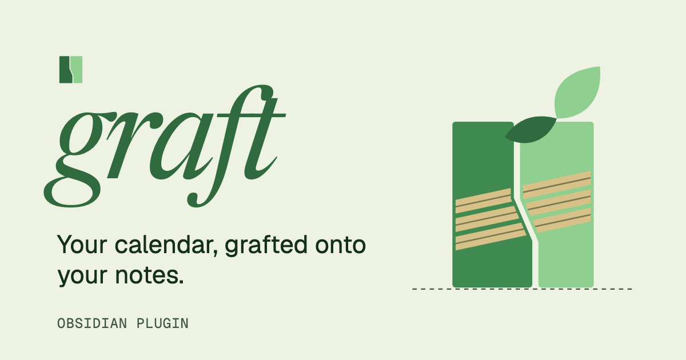
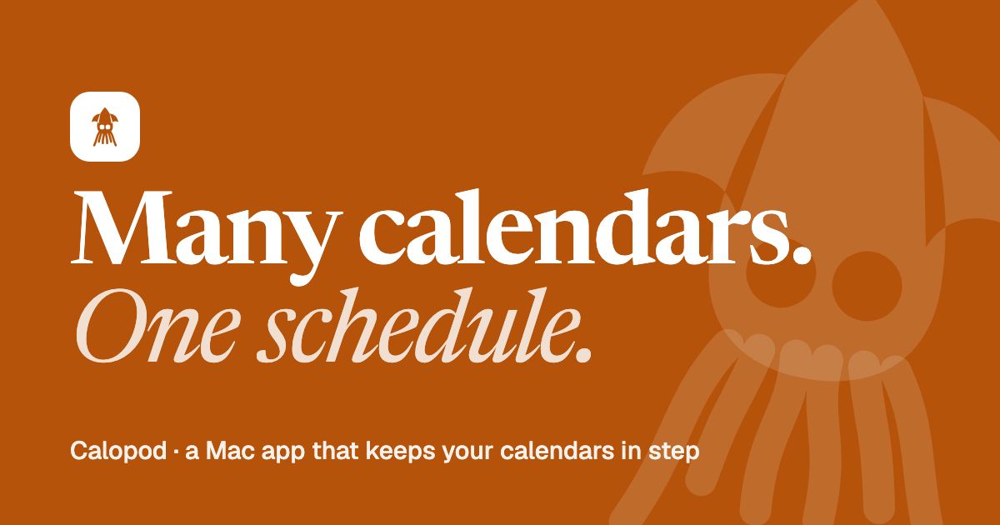
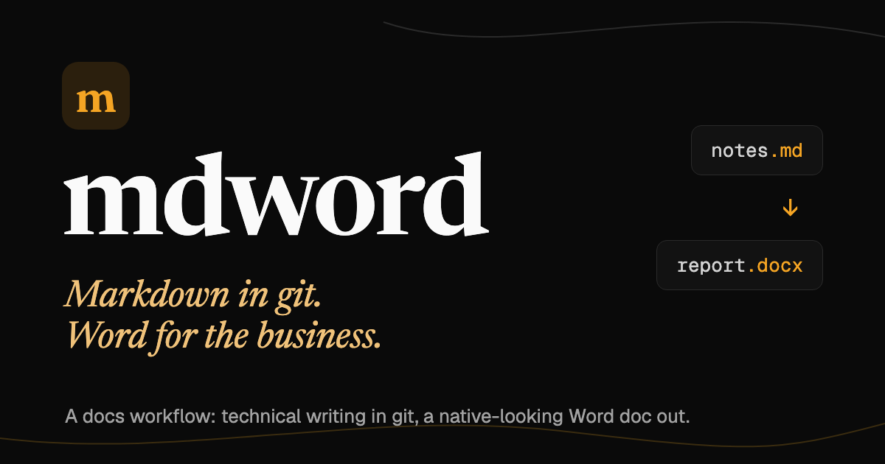
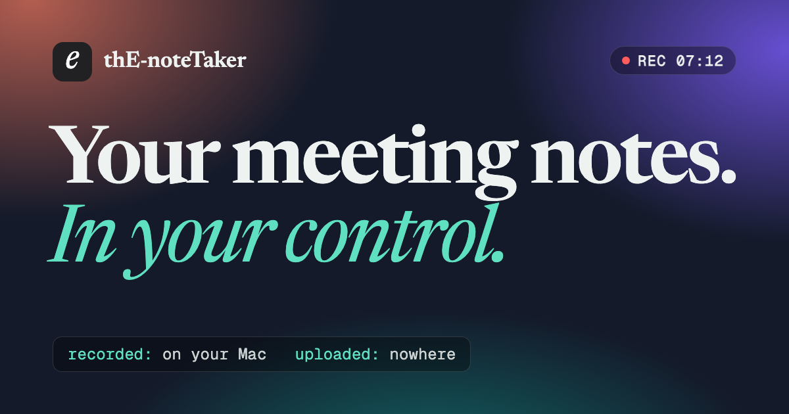

 

A real problem, solved for myself first. Some have been made solid enough to hand to someone else. Write-ups for all of it live at **[elijahquintana.pro](https://elijahquintana.pro)**.

 

> **NOW** 
> **Calopod** · Many calendars. One schedule. 
> **Graft** `WIP` · Your calendar, grafted onto your notes.

 

<table>
  <tr>
    <td width="50%" valign="top">
      
      
<b>Graft</b> IN PROGRESS · OCT 2026

      
An Obsidian plugin that reads Google and Outlook calendars and turns events into meeting notes that match a schema you already keep. It has a calendar view and optional automatic sync. Read-only, never touches the calendars.

      
<code>Obsidian Plugin</code> <code>Meeting notes</code> <code>Calendar sync</code> <code>TypeScript</code> <code>Obsidian API</code> <code>ICS</code>

    </td>
    <td width="50%" valign="top">
      
      
<b>Calopod</b> LIVE · SEP 2026

      
A local calendar hub for schedules split across accounts, as a Mac app and a command line with a read-only iPhone companion. It publishes one complete Main calendar, privacy-safe Busy mirrors, and unified Availability without editing source events.

      
<code>Calendar sync</code> <code>Privacy-first</code> <code>macOS</code> <code>iOS</code> <code>Swift</code> <code>EventKit</code>

    </td>
  </tr>
  <tr>
    <td><a href="https://graft.elijahquintana.pro">Project Site</a> · <a href="https://elijahquintana.pro/projects/graft/">About</a> · <a href="https://graft.elijahquintana.pro/features/">Features</a> · <a href="https://elijahquintana.pro/projects/graft/technical/">Technical</a></td>
    <td><a href="https://calopod.elijahquintana.pro">Project Site</a> · <a href="https://elijahquintana.pro/projects/calopod/">About</a> · <a href="https://elijahquintana.pro/projects/calopod/technical/">Technical</a> · <a href="https://elijahquintana.pro/projects/calopod/workflow/">Workflow</a> · <a href="https://github.com/ElijahQatana/calopod">GitHub</a></td>
  </tr>
  <tr>
    <td width="50%" valign="top">
      
      
<b>mdword</b> LIVE · SEP 2026

      
A small piece of documentation collaboration tooling that keeps technical writing in Markdown and git while still handing the business side a Word document that looks native to Word Online.

      
<code>Docs workflow</code> <code>Markdown</code> <code>shell</code> <code>pandoc</code>

    </td>
    <td width="50%" valign="top">
      
      
<b>thE-noteTaker</b> LIVE · JUN 2026

      
A Mac app that records, transcribes, and organizes your meetings on your own machine. You decide per recording whether AI ever sees it, sensitive recordings are isolated on disk, and everything is saved as open markdown and audio.

      
<code>AI tooling</code> <code>Meeting notes</code> <code>Privacy-first</code> <code>Swift</code> <code>SwiftUI</code> <code>AI</code>

    </td>
  </tr>
  <tr>
    <td><a href="https://elijahquintana.pro/projects/mdword/">About</a> · <a href="https://github.com/ElijahQatana/mdword">GitHub</a></td>
    <td><a href="https://notetaker.elijahquintana.pro">Project Site</a> · <a href="https://elijahquintana.pro/projects/the-notetaker/">About</a> · <a href="https://elijahquintana.pro/projects/the-notetaker/technical/">Technical</a> · <a href="https://elijahquintana.pro/projects/the-notetaker/workflow/">Workflow</a></td>
  </tr>
</table>

 

Swift · TypeScript · Bash · Astro · Tailwind · Cloudflare · Amazon Web Services

 

All projects at [elijahquintana.pro/work](https://elijahquintana.pro/work/)
